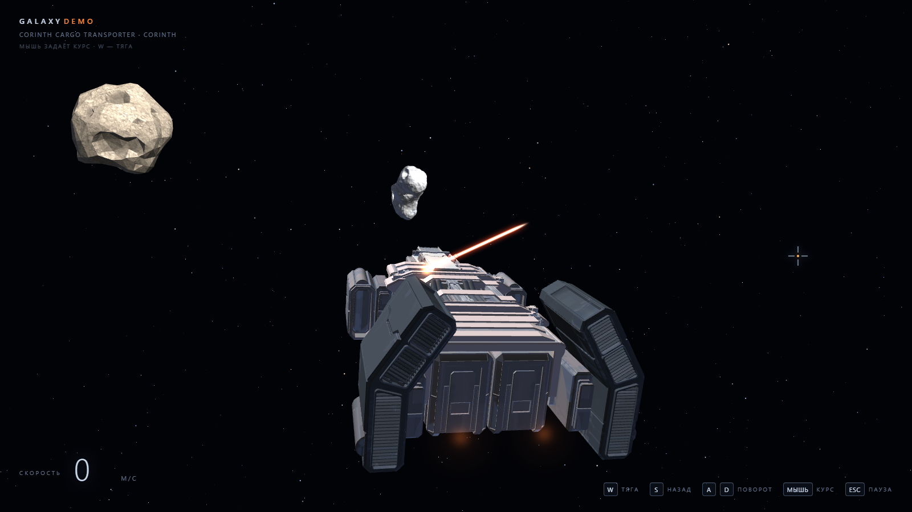

# GalaxyDemo — космический корабль на WebGL

Минималистичная игра: грузовой корабль **Corinth Cargo Transporter** в открытом космосе,
управление — WASD, Q/E и мышь. Никаких миссий, врагов и очков — чистый полёт.



Проект на Node.js без внешних зависимостей: статический сервер + собственный рендер на чистом WebGL.

## Запуск

Самый простой способ в Windows — двойной клик по **`start-server.bat`**: скрипт проверит Node.js,
запустит сервер и сам откроет игру в браузере. Окно консоли — это и есть сервер, закрывается по **Ctrl+C**.

То же самое из терминала:

```powershell
npm start          # без автооткрытия браузера
node server.js --open   # с автооткрытием
```

Откройте <http://localhost:3000>. Порт можно задать переменной окружения `PORT`.

Сцена задаётся в адресе: `http://localhost:3000/?scene=test-yard`.
По умолчанию открывается `open-space`. Как устроен формат и как собрать свою
сцену — [`docs/scenes.md`](docs/scenes.md).

Редактор сцен: <http://localhost:3000/editor.html> — дерево, инспектор, гизмо
и сохранение прямо в файл сцены. Импорт моделей — `.glb` через кнопку «Импорт GLB».

Редактор один и для сцены, и для префаба (`editor.html?prefab=<id>`): одни файлы и
одна логика. Правило и устройство окна — [`docs/editor.md`](docs/editor.md).

Кнопка **«Редактировать модель»** рядом с «+ Модель» открывает отдельное окно
(`model-editor.html?model=<id>`): там предпросмотр меша с коллайдером, габариты
модели и физика по умолчанию — `static`/`dynamic`, масса, отскок, трение и
коллайдер (`sphere`, `box` или `compound`). Они хранятся
в `public/models/<id>.physics.json` и подставляются новым объектам. У `compound`
части (боксы и сферы) собираются по треугольникам кнопкой **«Построить по модели»**,
правятся в списке и полями центра; мышь коллайдер не двигает. Кнопка
**«Переимпортировать»** заменяет меш модели из другого `.glb`, сохраняя id и физику.

В том же окне — дерево **частей модели**: объекты и группы из манифеста с галочками.
Галочка скрывает часть в предпросмотре, а кнопка **«Извлечь в модель»** сохраняет
отмеченные части отдельным ассетом (`public/models/<id>.json` + `.mesh.bin`,
текстуры переиспользуются). В инспекторе объекта сцены те же части показываются
галочками и пишутся в `hiddenParts`: так собирают модульный корабль — штатное
оборудование скрывают, а замену ставят отдельным дочерним объектом.

Правый клик по дереву сцены → **«Модель»** открывает таблицу моделей: имя
правится на месте и сохраняется сразу, **«Добавить»** ставит модель в сцену,
**«Изменить»** открывает `model-editor.html`, **«Удалить»** удаляет файлы
окончательно (если модель используется в сценах или префабах, появится
предупреждение со списком ссылок).

Кнопка **«Редактировать материал»** в инспекторе открывает
`material-editor.html?material=<id>`: предпросмотр сферы, поля из схемы и
**«Тест попадания»**. У щита в редакторе сцены есть такая же кнопка — пятно
видно прямо во вьюпорте, без запуска игры.

Корень сцены — объект **«Сцена»**: он один и не удаляется, в нём задаются фон кадра,
один файл стилей для всех HTML-слоёв HUD (`hud/style.css`) и модель игрока; все
остальные объекты — его дети. Формат файла — [`docs/scenes.md`](docs/scenes.md).
Префаб редактируется в отдельном окне: выберите его в списке и нажмите
**«Редактировать»** (или откройте `editor.html?prefab=<id>`) — в документе
будет только этот префаб, инструменты те же.

Если порт занят **другим** приложением, сервер напишет об этом и попробует следующий —
адрес всегда печатается в консоли, ориентируйтесь на него.

Если порт занят **уже запущенным GalaxyDemo**, второй сервер не поднимается: скрипт сообщит
об этом и просто откроет игру. Так повторные запуски не плодят процессы на портах 3000, 3001, 3002…

### Остановка

* **Ctrl+C** в окне сервера — обычный способ.
* **`stop-server.bat`** — если окно потерялось: скрипт найдёт и остановит все серверы GalaxyDemo.
  Закрывает только Node-процессы с точкой входа `server.js` на портах 3000–3010.

## Управление

| Клавиша | Действие |
|---------|----------|
| **W** | тяга вперёд |
| **S** | торможение / тяга назад |
| **A** | снос влево — вдоль правого вектора корпуса (RightVector) |
| **D** | снос вправо — вдоль правого вектора корпуса |
| **Q** | крен влево вокруг носа |
| **E** | крен вправо вокруг носа |
| **Мышь** | джойстик курса: смещение от центра экрана задаёт направление и силу разворота |
| **Колесо мыши (удерживать)** | обзор: движение мыши вращает камеру вокруг корабля, отпускание возвращает обычный вид |
| **1 / 2 / 3 / 4** | выбор оружия: лазер / лазерная указка / пулемёт / ракета |
| **ЛКМ** | спуск выбранного оружия; для указки — удержание |
| **F** | добыча: удерживать внутри зоны астероида |
| **F3** | показать/скрыть коллайдеры, триггеры и счётчики физики |
| **Esc** | пауза и панель настроек (повторно — продолжить) |

Как устроено управление:

* **Курсор — джойстик.** Смещение курсора от центра экрана считается в −1⋯1 по осям:
  направление задаёт, куда поворачивать, удалённость — насколько резко (у края экрана —
  полная скорость, в центре — мёртвая зона 0.06). Курс считает скрипт
  [`rotation.js`](public/scripts/rotation.js), а не камера.
* **Камера едет за корпусом** и мышью не крутится: она плавно доворачивается вслед за
  ориентацией корабля (постоянная ~0.1 с). Поэтому картинка не «хлёсткая»: мышь меняет курс
  корпуса, а вид просто следует за ним.
* **Маркер цели** — анимированный круглый таргет с вращающимися кольцами и тиками,
  размером с курсорное перекрестие (34×34). Корабль в центре кадра, таргет — точка прицела
  в 500 единицах по носу; в режиме обзора наведение отключено, чтобы можно было осмотреть корабль.
* **Пределы разворота**: скорость ограничена ползунком «Скорость поворота» (по умолчанию 2.6 рад/с),
  а угловое ускорение — 4 рад/с², поэтому старт и смена направления плавные, без рывка.
  Резкость отклика на курсор регулирует ползунок «Резкость мыши».
* Крен в вираж считается от угловой скорости и сглаживается (предел 20°): при смене
  направления корпус плавно перекладывается.
* **A/D — снос, а не поворот**: тяга идёт вдоль правого вектора корпуса (RightVector), поэтому
  корабль смещается боком, не меняя курс. Курс задаёт курсор.
* **Q/E — крен вокруг носа**: разгоняется и гаснет плавно, как тяга (3.2 рад/с², затухание 1.8 1/с,
  предел 1.8 рад/с), поэтому нет рывка в начале и обрыва в конце. Угол крена хранится в `rotation.js`
  и сам не снимается; от крена зависит, куда смотрит правый бок корпуса при сносе.
* **Обзор** — зажмите колесо мыши (средняя кнопка, СКМ) и ведите мышью: камера облетает корабль
  в его системе координат, поэтому учитываются наклон и крен корпуса. Пока обзор активен, курс
  корабля не меняется; после отпускания камера плавно возвращается в обычный вид. Тяга и физика
  продолжают работать.

Ориентация хранится кватернионом, поэтому корабль свободно крутится во все стороны, включая петли.

## Пауза и настройки

**Esc** полностью останавливает полёт — корабль замирает на месте, вращение и скорость сбрасываются,
курсор мыши освобождается — и в правом верхнем углу открывается панель:

| Настройка | Что меняет | Диапазон |
|-----------|------------|----------|
| **Модель корабля** | выбор меша: Corinth Cargo Transporter или Space Cruiser | — |
| **Высота камеры** | вертикальное расстояние от центра корабля до камеры | 0–200 |
| **Дистанция камеры** | насколько камера отодвинута назад | 0–120 |
| **Корабль ниже центра** | сдвиг корабля вниз по экрану: камера целится выше корабля | 0–15 |
| **Наклон камеры** | облёт вокруг оси корабля | 0–360° |
| **Скорость поворота** | предельная угловая скорость корабля, рад/с | 0.3–4.0 (по умолчанию 2.6) |
| **Резкость мыши** | как быстро корпус выходит на заданную скорость разворота; меньше — плавнее | 0.8–8.0 (по умолчанию 2.8) |
| **Скорость движения** | максимальная скорость полёта, м/с | 10–200 (по умолчанию 85) |

Значения камеры берутся из скрипта `camera.js` на объекте камеры текущей сцены:
его параметры `height`, `distance`, `drop`, `tilt`, `fov` и `lag` применяются сразу,
а слайдеры меню подкручивают их на ходу. Изменения применяются сразу: камера
переезжает по высоте прямо на паузе, а новые пределы скорости и поворота
начинают действовать после возврата в полёт. Повторный **Esc** прячет панель и
возвращает управление; корабль стартует с нулевой скорости, без рывка.

Камеру задаёт только сцена — у движка нет собственных значений кадра. Если в сцене
нет ни объекта «камера», ни скрипта `camera.js`, игра не рисует 3D: виден только
фон сцены (по умолчанию чёрный), а ползунки камеры в паузе скрыты.

Кнопка **«Перейти в редактор»** открывает `editor.html` с текущей сценой.

### Два корабля и свои настройки у каждого

В панели есть выбор меша: **Corinth Cargo Transporter** (по умолчанию) и **Space Cruiser**
(второй меш из `space-ship.zip`). У каждого корабля свои настройки полёта — скорость поворота
и скорость движения; при переключении подставляются значения этого корабля,
а правки слайдеров запоминаются именно для него. Для Space Cruiser значения по умолчанию:
скорость поворота **2.2**, скорость движения **120**.

Второй корабль собирается командой `node tools/build-spaceship.mjs`: скрипт читает бинарный FBX
(`assets/spaceship/space-ship.fbx`), вытаскивает геометрию и UV, разворачивает носом в −Z,
центрирует и масштабирует до 9 единиц. Текстура — `python tools/prepare-spaceship-textures.py`
(цвет из `space-ship.zip`, ровные rough/metal).

## Как задать модель корабля вручную

Всё выбирается в `public/ship.config.json`:

```json
{ "model": "corinth" }
```

| Значение | Что загрузится |
|----------|----------------|
| `corinth` | готовый ассет `public/models/corinth.*` (по умолчанию) |
| `obj` | ваш файл `public/models/ship.obj` |
| `spec` | описание из примитивов `public/ship-model.json` |

### Вариант 1. Свой OBJ

Положите файл в `public/models/ship.obj` и поставьте `"model": "obj"`.
Модель автоматически центрируется и масштабируется так, чтобы длина стала ≈ 7.4 единицы.
Ориентация: **нос смотрит в −Z**, верх — +Y.

### Вариант 2. Описание из примитивов

`public/ship-model.json` — обычный JSON, правится в блокноте, перезагрузка страницы сразу показывает результат.
Координаты: центр корабля в нуле, нос в −Z, верх +Y, углы в градусах.

```json
{
  "parts": [
    {
      "shape": "hull",
      "pos": [0, 0, 0],
      "size": [1.6, 1.0, 5.6],
      "color": "#6c7889"
    }
  ],
  "thrusters": [
    { "pos": [-1.35, -0.26, 3.5], "size": 0.95 }
  ]
}
```

Доступные фигуры:

| `shape` | Параметры | Что это |
|---------|-----------|---------|
| `box` | `size: [x, y, z]` | параллелепипед |
| `wedge` | `size`, `tip` (0…1) | клин, сходящийся к носу |
| `cylinder` | `size: [диаметр, диаметр, длина]`, `segments` | цилиндр вдоль Z (двигатели, сопла) |
| `sphere` | `size: [диаметр X, Y, Z]`, `segments`, `rings` | сфера/эллипсоид (фонарь кабины) |
| `hull` | `size: [ширина, высота, длина]`, `noseLength`, `tailScale`, `sides` | гранёный фюзеляж |
| `wing` | `size: [размах, толщина, хорда]`, `taper`, `sweep`, `dihedral` | крыло с сужением и стреловидностью |

Общие поля детали: `name`, `pos`, `rot` (градусы `[x, y, z]`), `color` (`#rrggbb`),
`glow` + `glowIntensity` (свечение), `specular`, `metal`.

`thrusters` — точки, где рисуется свечение двигателей: `pos` и `size`.

### Пересборка ассета Corinth

Исходник лежит в `assets/corinth/Corinth_Cargo_Transporter.obj` (распакован из
`corinth-cargo-transporter.zip`). Если поменяли исходник — пересоберите бинарный ассет:

```powershell
node tools/build-corinth.mjs
```

Скрипт убирает фигуру пилота, поворачивает корабль носом в −Z, центрирует, считает
нормали, назначает материалы и складывает всё в `public/models/corinth.json` +
`corinth.mesh.bin`.

## Материалы и текстуры

В архиве лежат PBR-атласы 4096×4096: обшивка, кабина, контейнеры, двигатели, шасси,
трубы, антенны, стёкла. Игра использует четыре набора, ужатых до 1024 (цвет) и 512
(roughness/metallic):

```powershell
npm run textures      # python tools/prepare-textures.py
```

Скрипт читает PNG прямо из `corinth-cargo-transporter.zip` и раскладывает результат в
`public/textures/<set>/{base,rough,metal}.png` — всего около 2.5 МБ.

Как это работает в шейдере (`public/js/main.js`):

* **base color** даёт рельеф и потёртости: из атласа берётся яркость (с лёгким оттенком),
  а цвет детали задаёт палитра в `tools/build-corinth.mjs`;
* **roughness** управляет резкостью блика, **metallic** — силой металлического отражения;
* UV-развёртка хранится в бинарном меше (атрибут `aUv`), V переворачивается при выборке.

Такой подход выбран потому, что в архиве нет `.mtl` и нельзя однозначно сопоставить
группы модели с конкретным атласом: цветовые пятна чужой развёртки выглядели бы как
случайная раскраска, а так остаются только панели, износ и металл.

Импортированные через редактор GLB-модели рисуются иначе: у них верные UV и материалы,
поэтому цвет берётся из `base.png` напрямую (поле `textureColor` в манифесте).
Карты `rough.png` / `metal.png` у таких наборов не запрашиваются — вместо них
подставляются однотонные, поэтому в консоли нет 404 на отсутствующие файлы.

## Оружие

Четыре вида оружия. Выбор — клавиши **1–4** или клик по панели **«ОРУЖИЕ»**
внизу экрана. Вся логика — режимы, очередь, трассеры, ракеты, перезарядка — живёт
в скрипте сцены [`public/scripts/weapons.js`](public/scripts/weapons.js); движок
больше не знает про оружие и только рисует эффекты, которые присылает скрипт.

| Клавиша | Оружие | Как стреляет |
|---------|--------|--------------|
| **1** | Лазер | ЛКМ — одиночный импульс, луч живёт 0.45 с |
| **2** | Лазерная указка | Луч горит, пока удерживается ЛКМ; отпускание сразу скрывает |
| **3** | Пулемёт | Очередь из 25 трассеров с интервалом 0.2 с; первый — сразу |
| **4** | Ракета | Один пуск; летит сущность из префаба `rocket`, попадание считает свип |

Все виды оружия стреляют в одну **мировую точку попадания** — в 500 единицах от носа
корабля вдоль его оси. Корабль автоматически доворачивается так, чтобы её проекция была
в центре кадра, а на самой точке рисуется анимированный круглый таргет.

Точки выстрела — пустые объекты `gun-left` / `gun-right` на корабле. Скрипт чередует
их и стреляет из мировых позиций этих узлов; если ссылки не заданы, стреляет из носа.
Все параметры (количество в очереди, интервалы, перезарядка, скорости, жизнь снарядов,
толщина луча) редактируются в инспекторе редактора в секции «Скрипты».

HUD оружия — отдельный слой [`public/hud/weapons.html`](public/hud/weapons.html):
подсветка выбранного оружия, статус «ГОТОВ / ОЧЕРЕДЬ / ПЕРЕЗАРЯДКА / ЛУЧ АКТИВЕН».
Скрипт обновляет его через `api.hud.setText` / `setClass` / `onClick`.

**Подробная инструкция по оружию:** [`docs/weapons.md`](docs/weapons.md) — режимы, тайминги,
HUD, внутреннее устройство и как добавить своё оружие.

Прицел — это сущность `reticle` (размер и цвета) и скрипт-дизайн из
`public/scripts/reticles`; форма хранится в `public/hud/reticles/*.svg` или
рисуется на canvas. Состояния наведения и попадания, кольцо перезарядки и
предпросмотр в редакторе — [`docs/reticles.md`](docs/reticles.md).

### Ракета — сущность из префаба

Ракета больше не процедурный эффект: `weapons.js` просит систему снарядов
выстрелить префабом `rocket` из `public/prefabs/rocket.json`. В префабе — меш
`rocket`, слот дымного следа `trail` и блок `projectile`:

```json
"projectile": {
  "speed": 95, "life": 6, "radius": 0.42,
  "damage": 25, "impulse": 40,
  "impact": "impact-spark", "trail": "smoke-trail"
}
```

Тела у ракеты нет: при 95 м/с дискретное тело за кадр проходит ~1.5 м и
проскакивает тонкую обшивку. Вместо этого отрезок «было → стало» проверяется
свипом сферы радиуса `radius` по сферам и боксам тел сцены; попадание
срабатывает один раз и даёт точку, нормаль и импульс цели.

Пул прогревается при загрузке сцены: выстрел не создаёт сущностей, а показывает
готовую ракету и включает след. Спящие ракеты не дымят. Если префаб не
собрался, в консоли есть предупреждение `[projectiles]`, а ракета не стреляет:
процедурного запасного пути в движке больше нет. Id префаба задаёт параметр
**«Ракета: префаб»** в инспекторе.

## Боты

Префаб **«Бот»** (`public/prefabs/bot.json`) — корпус `spaceship` со скриптом
[`bots/aim-attack.js`](public/scripts/bots/aim-attack.js). Бот находит игрока
в конусе обзора (`range`, `fovDeg`), после захвата доворачивает корпус куда угодно
и стреляет снарядами из префаба `rocket` — без ограничения по положению игрока.

Обнаруживший бот рассылает событие `bot.contact`: соседи в радиусе `squadRange`
доворачиваются к точке контакта, но стреляют только по собственному зрению.
Цель удерживается `loseGrace` секунд после выхода из конуса.

Демо-сцена: `http://localhost:3000/?scene=bots-demo`.

**Подробно:** [`docs/bots.md`](docs/bots.md) — параметры, события, ограничения.


## Астероиды

В сцене два статичных астероида — это физические тела сферической формы, они служат ориентирами
и не пересекаются:

| Астероид | Позиция | Масштаб | Радиус коллайдера |
|----------|---------|---------|-------------------|
| `asteroid1` (asteroid-01.zip) | −30, 7, −96 | 1.15 | 9.36 |
| `asteroid2` (asteroid-with-minerals.zip) | 31, −11, −130 | 1.45 | 11.66 |

Расстояние между центрами 72.1 — при сумме радиусов 21.0 они гарантированно не пересекаются.
При расстановке `layoutAsteroids()` сам проверяет сферы и разводит объекты по X, если они пересеклись.
Астероиды медленно вращаются вокруг своей оси.

Сборка: `node tools/build-asteroids.mjs` (FBX и OBJ из `assets/asteroids/`),
текстуры: `python tools/prepare-asteroid-textures.py` (альбедо из архивов, ровные rough/metal).
Второй астероид использует карту металла из архива.

## Добыча ресурсов

Вокруг каждого астероида есть **зона добычи** — сфера радиусом вдвое больше
сферы коллизии камня. При входе в неё сверху по центру мерцает надпись
«Собрать ресурсы», а под ней появляется полоса добычи и счётчик.

Удерживайте **F** внутри зоны: из пустого объекта `mining-origin` на корабле
бьёт добывающий лазер. Направление берётся из позиции мыши (`input.cursorRay`),
луч попадает точно в точку камня под курсором (пересечение по треугольникам
меша), в точке попадания пульсируют искры. Полный цикл — 2.6 с, за него
начисляется одна единица ресурсов; счётчик остаётся на экране и вне зоны.
Если отпустить F или выйти из зоны, прогресс плавно остывает, а набранные
ресурсы сохраняются.

Вся логика — зона, прогресс, ресурсы, луч и искры — в скрипте
[`public/scripts/mining.js`](public/scripts/mining.js); HUD — отдельный слой
[`public/hud/mining.html`](public/hud/mining.html). Геометрия луча осталась
в [`public/js/mining.js`](public/js/mining.js) как утилита без состояния.
Параметры (`origin`, `range`, `cycleTime`, `decay`) редактируются в инспекторе.

## Физика: корабли и астероиды

Столкновения считает отдельный модуль [`public/js/physics.js`](public/js/physics.js). Он не зависит
от WebGL и DOM: тот же код работает в браузере и в Node, поэтому физику можно проверять тестами
без запуска игры.

Корабль и астероиды — не просто меши: это **твёрдые тела** с массой, скоростью, ориентацией и
коллайдером. Игровой слой только передаёт телу управление и читает результат, а всю математику
контактов делает физический мир.

### Как устроена система

* **Тело** (`Body`) хранит массу, позицию, кватернион, линейную и угловую скорость, материал
  (`restitution`, `friction`) и коллайдер. `type: 'static'` или `mass: 0` — неподвижное тело:
  импульсы его не двигают, но контакты с ним решаются.
* **Коллайдер** — сфера, бокс или compound: набор сфер и боксов с локальными offset и размерами.
  У корабля три сферы вдоль оси Z (нос, центр, корма), у астероида одна; корпус корабля можно
  собрать из боксов по мешу в редакторе модели. Сферы дешевы и устойчивы, боксы точнее
  повторяют плоские грани; compound перебирает части попарно и даёт контакты бокс-бокс,
  бокс-сфера и сфера-сфера.
* **Корабль** — динамическое тело `mass: 12` с `lockRotation: true`: ориентацией управляет игрок,
  поэтому физика двигает только позицию, а не закручивает корпус.
* **Астероиды** — статические тела. Они участвуют в контактах и отбрасывают корабль, но сами
  остаются на месте, как и раньше.
* **Шаг симуляции** — фиксированный `1/120 с` с накоплением времени и ограничением подшагов.
  Поэтому поведение не зависит от FPS: при 30 и 144 кадрах в секунду удар считается одинаково.
* **Broad phase** — sweep and prune по AABB: перебираются не все пары тел, а только пересекающиеся
  по осям. **Narrow phase** — пересечение сфер, бокс-сфера и бокс-бокс (SAT с точками контакта).
* **Решатель** — последовательные импульсы: накопленный нормальный импульс с ограничением,
  восстановление скорости (`restitution`), трение Кулона и порог скорости сближения, чтобы тело
  не дрожало от микрокасаний. Остаточное проникновение убирает позиционная коррекция с `slop`.
* **События** — `contact` (тела соприкасаются) и `impact` (скорость сближения выше порога).
  На `impact` подписана игра: она добавляет тряску камере.

### Параметры столкновения

| Параметр | Значение |
|----------|----------|
| Масса корабля | 12 |
| Радиус сферы корпуса Corinth | 3.68, центры на ±4.13 по Z |
| Коэффициент восстановления | 0.55 |
| Трение корабля / астероида | 0.18 / 0.20 |
| Фиксированный шаг | 1/120 с, до 6 подшагов на кадр |
| Итерации решателя | 10 |
| Порог события `impact` | 2 м/с |

При касании корабль выталкивается из астероида, нормальная составляющая скорости отражается
с коэффициентом **0.55**, касательная гасится трением. В момент удара камера коротко вздрагивает;
амплитуда зависит от скорости сближения. Для Corinth касание происходит, когда центр корабля
примерно в 17.17 от центра астероида 1.

### Как пользоваться

Минимальный пример — свой мир, статический астероид и динамический корабль:

```js
import { PhysicsWorld, sphereShape, compoundShape } from './physics.js';

const world = new PhysicsWorld({
  gravity: [0, 0, 0],
  fixedStep: 1 / 120,
  maxSubSteps: 6,
  iterations: 10
});

// Астероид: масса не нужна — тело статическое
const asteroid = world.addBody({
  name: 'asteroid1',
  type: 'static',
  position: [-30, 7, -96],
  restitution: 0.55,
  friction: 0.2,
  shape: sphereShape(9.36)
});

// Корабль: три сферы вдоль корпуса, вращение задаёт игра
const ship = world.addBody({
  name: 'ship',
  mass: 12,
  position: [0, 0, 0],
  lockRotation: true,
  restitution: 0.55,
  friction: 0.18,
  shape: compoundShape([
    { offset: [0, 0, -4.1], radius: 3.7 },
    { offset: [0, 0, 0], radius: 3.7 },
    { offset: [0, 0, 4.1], radius: 3.7 }
  ])
});

world.on('impact', (event) => {
  console.log(`удар ${event.speed.toFixed(1)} м/с, импульс ${event.impulse.toFixed(1)}`);
  console.log('точка контакта:', event.point);
});

// Каждый кадр: состояние игры → тело
world.syncBody(ship, {
  position: gameShip.pos,
  quaternion: gameShip.quat,
  velocity: gameShip.vel
});

world.step(dt); // внутри — фиксированные подшаги

// Тело → состояние игры. Массивы можно читать напрямую или копировать значения.
gameShip.pos = ship.position;
gameShip.vel = ship.velocity;
```

`world.step(dt)` можно вызывать с любым `dt`: мир сам разобьёт его на фиксированные шаги
(до `maxSubSteps`; излишек отбрасывается, чтобы не было spiral of death).
Если игра была на паузе, вызовите `world.resetClock()`, чтобы не догонять накопленное время.

**Основное API:**

| Метод / свойство | Назначение |
|------------------|------------|
| `new PhysicsWorld(options)` | создать мир: `gravity`, `fixedStep`, `maxSubSteps`, `iterations`, `slop`, `impactThreshold` |
| `world.addBody(definition)` | добавить тело; возвращает `Body` |
| `world.removeBody(bodyOrId)` / `world.clear()` | убрать тело / очистить мир |
| `world.step(dt)` | продвинуть мир на `dt` с фиксированными подшагами |
| `world.stepFixed(h)` | ровно один подшаг (для детерминированных тестов) |
| `world.syncBody(body, state)` | скопировать `position`, `quaternion`, `velocity`, `angularVelocity` в тело |
| `world.applyImpulse(body, impulse, point?)` | приложить импульс в мировой точке |
| `world.on('impact', fn)` / `world.on('contact', fn)` | подписка на события; возвращает функцию отписки |
| `world.bodies`, `world.contacts`, `world.stats` | тела, контакты последнего шага, счётчики |
| `body.position`, `body.velocity`, `body.mass`, `body.isStatic` | состояние и масса тела |
| `sphereShape(r)`, `compoundShape([...])` | сферический и составной коллайдеры |
| `getWorldSpheres(body)` | мировые центры и радиусы сфер — для отладки и запросов |

**Примеры:**

```js
// Толкнуть корабль взрывом: импульс = масса × желаемая дельта скорости
const deltaV = 14;
world.applyImpulse(ship, [0, 0, -ship.mass * deltaV]);

// Подвижный астероид: уберите type: 'static' и задайте большую массу.
// Чем больше масса, тем меньше астероид реагирует на удар.
const rock = world.addBody({
  mass: 5000,
  position: [20, 0, -80],
  shape: sphereShape(6),
  restitution: 0.55,
  friction: 0.2
});

// Проверить, что происходит внутри
console.log(world.stats);       // { bodies, pairs, contacts, steps, impacts }
console.log(world.contacts);    // контакты последнего шага
```

Модель корабля даёт свои `collision.points` и `collision.radius` (см. `public/js/ship.js`).
При переключении меша в паузе `main.js` автоматически пересобирает коллайдер под новый корпус.

### Отладка

* **F3** (или `?debug=1`) включает отладочный слой: сетка сфер — корпус корабля (голубая)
  и препятствия (оранжевая), рёбра боксов, зелёные объёмы триггеров и красные кресты —
  точки контактов. Всё это чистые линии без заливки и текстур.
* В консоли браузера доступны `__galaxy.physics`, `__galaxy.physics.stats`, `__galaxy.shipBody`,
  `__galaxy.orbit` (текущие углы обзора), `__galaxy.target` (мировая цель и её экранная проекция),
  журнал последних ударов `__galaxy.impacts` и состояние добычи `__galaxy.mining`.
* `npm test` запускает тесты физики (отскок, импульсы, составной корпус, события, частота кадров),
  оружия (выбор режимов, импульс, удержание, очередь 25×0.2, ракета, перезарядка)
  и добычи (луч по сфере, прогресс, выдача ресурсов, остывание).

В игре `updateShip()` перед `physics.step(dt)` копирует позицию, кватернион и скорость корабля
в тело, а после шага забирает результат обратно. Ориентация остаётся за игроком, поэтому корабль
по-прежнему слушается мыши, WASD и Q/E, а физика отвечает только за столкновения и отскок.

## Структура

```
server.js                 статический сервер (Node, без зависимостей)
start-server.bat          запуск двойным кликом: проверка Node, старт, автооткрытие браузера
stop-server.bat           остановка всех серверов GalaxyDemo (tools/stop-server.ps1)
public/
  index.html              разметка страницы и контейнер #scene-hud
  style.css               каркас движка: canvas, контейнер HUD, загрузочный экран
  model-editor.html       отдельное окно: физика модели (static/dynamic, масса, коллайдер)
  model-editor.css        стили окна редактора модели
  material-editor.html    окно материала: предпросмотр сферы и параметры
  material-editor.css     стили окна материала
  hud/
    style.css             стили HUD сцены (подключаются из объекта «Сцена»)
    loading.html          загрузочный экран: HTML из поля loadingFile скрипта сцены
    *.html                разметка слоёв: меню, оружие, добыча, клавиши и т.д.
  ship.config.json        выбор модели по умолчанию
  ship-model.json         ручное описание корабля из примитивов
  models/                 Corinth, Space Cruiser и ракета (json + bin с UV)
                          <id>.physics.json — физика модели по умолчанию
  effects/                VFX-описания <id>.effect.json (params + layers)
  skyboxes/               небо: cube/<id>-{px,nx,py,ny,pz,nz}.jpg, превью <id>.jpg,
                          <id>-thumb.jpg, index.json (tools/build-skyboxes.py)
  materials/              материалы как данные: <id>.material.json (щит и др.)
  textures/               атласы материалов (base / rough / metal)
  js/
    main.js               сцена, полёт, камера, HUD
    physics.js            физика: фасад тел, коллайдеров и контактов
    physics/
      shapes.js           формы и мировые запросы
      narrowphase.js      сфера-бокс, бокс-бокс, сфера-сфера
      world.js            Body и PhysicsWorld
    mining.js             геометрия луча: сферы, треугольники, hitTest
    effects.js            примитивы и VFX-инстансы: пул, привязка, слои
    materials.js          материалы: нормализация схемы и uniform'ов
    render/shield-shader.js шейдер щита: френель, гекс, пятно, кольцо
    prefabs.js            префабы: клон, id, нормализация projectile
    model-split.js        части модели: дерево и извлечение в новый ассет
    prefab-runtime.js     сборка поддерева префаба в рантайме (spawn/despawn)
    projectiles.js        снаряды: свип-сфера, попадания, срок жизни
    projectile-pool.js    пул прогретых снарядов без аллокаций
    ship.js               загрузчики моделей и текстур
    geometry.js           процедурные меши
    gl.js                 шейдеры и буферы
    math.js               матрицы, кватернионы, векторы
    editor/
      editor.js           редактор сцен и префабов
      model-editor.js     окно модели: физика и сборка коллайдера
      material-editor.js  окно материала: предпросмотр и параметры
      collider-fit.js     автоколлайдер: фасад и утилиты
      collider/
        voxelizer.js      вокселизация и sealGaps
        box-merger.js      покрытие и слияние боксов
        box-collider.js    сборка боксов
        sphere-packer.js   сферы и hybrid
  scripts/weapons.js      панель оружия и лазеры (выбор слота, импульс, указка)
  scripts/machinegun.js   пулемёт: массив точек вылета, очередь, трассеры
  scripts/rocket.js       ракета: точка пуска, перезарядка, запуск префаба
  scripts/bots/vision.js  зрение бота: конус, упреждение, доворот
  scripts/bots/aim-attack.js бот-турель: захват игрока и огонь
  scripts/loading.js      скрипт загрузочного экрана: прогресс и время
  scripts/mining.js       добыча: зона, прогресс, ресурсы, луч, HUD
docs/weapons.md           подробная инструкция по оружию
docs/bots.md              боты: зрение, атака, параметры
docs/materials.md         материалы как данные, щит
docs/shield-mesh.md       правило: как сделать меш щита
docs/architecture.md      слои коллайдеров, физики и VFX
tools/build-corinth.mjs   сборка ассета Corinth из OBJ
tools/build-rocket.mjs    сборка ассета ракеты из процедурных примитивов
tools/model-scale.mjs     масштабирование модели на месте (тот же id)
tools/build-spaceship.mjs сборка ассета Space Cruiser из FBX
tools/build-asteroids.mjs сборка двух астероидов (FBX + OBJ)
tools/fbx-lib.mjs         мини-парсер бинарного FBX
tools/prepare-textures.py текстуры Corinth из архива
tools/stop-server.ps1     поиск и остановка серверов GalaxyDemo по портам 3000–3010
tools/prepare-spaceship-textures.py текстуры Space Cruiser
assets/corinth/           исходный OBJ
assets/spaceship/         исходный FBX
assets/asteroids/         исходные FBX и OBJ астероидов
tests/physics.test.mjs    тесты физики (npm test)
tests/collider-fit.test.mjs тесты автоколлайдера (npm test)
tests/rocket-asset.test.mjs тесты ассета и префаба ракеты (npm test)
tests/bot-ai.test.mjs    тесты зрения и атаки бота (npm test)
tests/prefabs.test.mjs    тесты префабов и блока projectile (npm test)
tests/projectiles.test.mjs тесты свипа и полёта снарядов (npm test)
tests/projectile-pool.test.mjs тесты пула снарядов (npm test)
tests/weapons.test.mjs    тесты скрипта оружия (npm test)
tests/mining.test.mjs     тесты добычи (npm test)
```

## Отладочные параметры

* `?cam=dx,dy,dz` — посмотреть корабль с другого ракурса, например `?cam=20,3,0` (вид сбоку).
* `?debug=1` — сразу включить отладочные коллайдеры и счётчики физики; **F3** переключает их в полёте.
